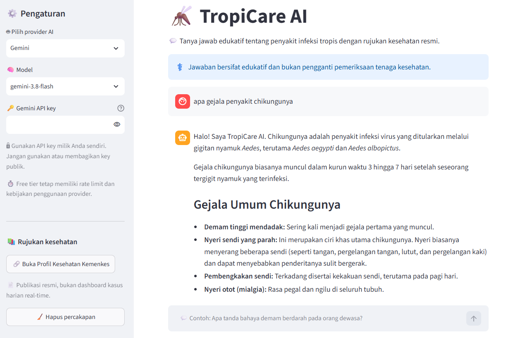

# 🦟 TropiCare AI

Chatbot edukasi tentang penyakit menular tropis menggunakan Python, Streamlit, dan Gemini API.

## 💡 Mengapa TropiCare AI?

Informasi tentang penyakit menular tropis sering tersebar di banyak sumber dan sulit dipahami dalam konteks pertanyaan sehari-hari. TropiCare AI membantu pengguna memulai pencarian informasi melalui percakapan yang sederhana, terarah, dan menggunakan bahasa pengguna.

Chatbot ini dapat membantu pengguna untuk:

- Memahami perbedaan penyakit seperti malaria, demam berdarah, chikungunya, tuberkulosis, dan leptospirosis secara umum.
- Mempelajari gejala umum, cara penularan, faktor risiko, pencegahan, dan pilihan penanganan yang perlu didiskusikan dengan tenaga kesehatan.
- Mengenali tanda bahaya yang memerlukan pemeriksaan segera tanpa mencoba menetapkan diagnosis.
- Menyusun pertanyaan yang lebih baik sebelum berkonsultasi dengan dokter, puskesmas, atau fasilitas kesehatan lainnya.
- Menemukan rujukan publikasi kesehatan resmi melalui halaman Profil Kesehatan Kementerian Kesehatan Republik Indonesia.

## 🎯 Target pengguna

### 👥 Masyarakat umum

Mendapatkan penjelasan awal yang lebih mudah dipahami ketika mencari informasi tentang gejala, penularan, pencegahan, atau istilah kesehatan. Chatbot membantu mengarahkan pengguna pada tanda bahaya dan sumber resmi, tetapi tidak menggantikan pemeriksaan medis.

### 🎓 Pelajar dan mahasiswa

Memperoleh teman belajar untuk memahami konsep penyakit menular tropis, membandingkan karakteristik beberapa penyakit, serta membuat pertanyaan atau rangkuman untuk tugas dan diskusi. Jawaban tetap perlu diverifikasi dengan buku ajar dan sumber akademik.

### 🧑‍🏫 Guru, dosen, dan fasilitator edukasi kesehatan

Mendapatkan titik awal untuk menyusun contoh tanya jawab, materi diskusi, atau aktivitas literasi kesehatan yang relevan dengan konteks Indonesia. Informasi yang digunakan untuk pengajaran perlu diperiksa kembali pada sumber resmi.

### 🤝 Kader dan relawan kesehatan

Membantu menyiapkan penjelasan awam tentang pencegahan, penularan, dan kapan seseorang perlu dirujuk ke fasilitas kesehatan. Chatbot bukan alat pencatatan kasus, diagnosis, atau pengganti protokol layanan.

## ✨ Fitur utama

- 💬 Chat interaktif dengan Gemini.
- Pilihan provider AI melalui dropdown: Gemini atau Groq Free Tier.
- Input API key provider yang dipilih melalui sidebar.
- Dukungan pertanyaan tentang malaria, demam berdarah, gejala, pencegahan, penularan, dan penanganan secara edukatif.
- 🛡️ Guardrail agar chatbot tidak mendiagnosis atau memberikan dosis obat personal.
- Rujukan ke halaman resmi [Profil Kesehatan Kemenkes](https://www.kemkes.go.id/id/category/profil-kesehatan).
- Penanganan API key, error jaringan, kuota, dan percakapan per sesi.

## 🤖 Pilihan provider AI

### ✨ Gemini

Gunakan API key dari [Google AI Studio](https://aistudio.google.com/apikey). Gemini tetap menjadi provider utama dan dipanggil menggunakan SDK resmi `google-genai`.

### ⚡ Groq Free Tier

Gunakan API key dari [Groq Console](https://console.groq.com/keys). Groq dipanggil menggunakan endpoint OpenAI-compatible dan model `llama-3.3-70b-versatile`. Free tier membantu sebagai alternatif ketika Gemini sedang terkena rate limit, tetapi tetap memiliki batas penggunaan dan kebijakan provider.

API key bukan public key. Setiap pengguna atau pemilik deployment harus menggunakan key miliknya sendiri. Jangan menaruh key di repository, screenshot, README, atau membagikannya kepada pengguna lain.

## 💬 Contoh pertanyaan

- Apa perbedaan gejala awal malaria dan demam berdarah?
- Bagaimana cara mencegah perkembangbiakan nyamuk Aedes di rumah?
- Apa tanda bahaya demam berdarah yang membutuhkan pertolongan segera?
- Apa yang perlu saya tanyakan kepada dokter ketika mengalami demam setelah bepergian?
- Di mana saya dapat memeriksa publikasi kesehatan resmi terbaru dari Kemenkes?

## 🖼️ Screenshot

Tambahkan gambar aplikasi ke `assets/screenshot.png`, lalu gambar tersebut akan tampil di bagian ini:



## 🚀 Local deployment

```bash
conda activate [python-environment]
pip install -r requirements.txt
streamlit run app.py
```

Masukkan Gemini API key melalui sidebar saat aplikasi berjalan. Alternatifnya, buat `.streamlit/secrets.toml` secara lokal:

```toml
GEMINI_API_KEY = "your-api-key"
GROQ_API_KEY = "your-api-key"
```

File tersebut sudah masuk `.gitignore` dan tidak boleh di-commit.

## ☁️ Deploy ke Streamlit Community Cloud

1. Push repository ke GitHub tanpa `.streamlit/secrets.toml` atau file `.env`.
2. Buat aplikasi baru di Streamlit Community Cloud.
3. Pilih repository dan file utama `app.py`.
4. Di pengaturan **Secrets**, tambahkan satu atau kedua secret berikut sesuai provider yang ingin digunakan:

```toml
GEMINI_API_KEY = "your-api-key"
GROQ_API_KEY = "your-api-key"
```

5. Deploy dan uji pertanyaan sederhana sebelum membagikan URL aplikasi.

## ⚠️ Batasan sumber 

Halaman Profil Kesehatan Kemenkes merupakan indeks publikasi resmi, bukan dashboard kasus harian. Aplikasi tidak boleh mengarang angka kasus terkini. Untuk laporan terbaru, periksa publikasi dan sumber resmi terkait, lalu cantumkan tanggal serta tautannya.

Jawaban chatbot bersifat edukatif dan bukan pengganti pemeriksaan atau nasihat tenaga kesehatan. Jangan masukkan identitas pribadi atau data medis sensitif ke dalam chat.
